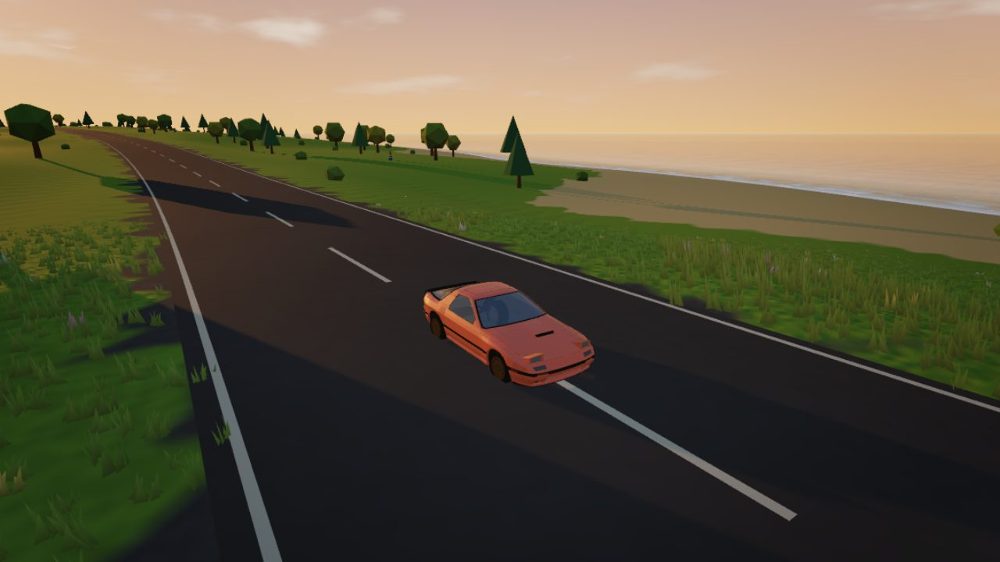
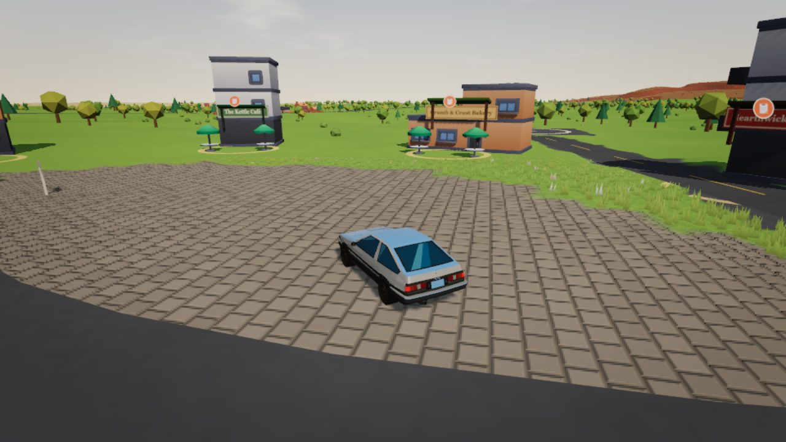
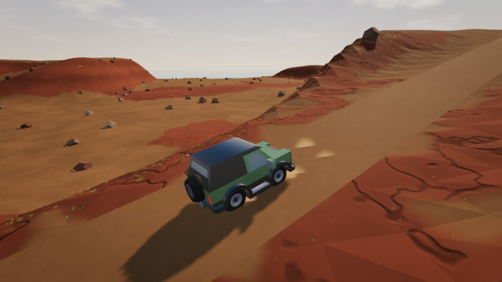
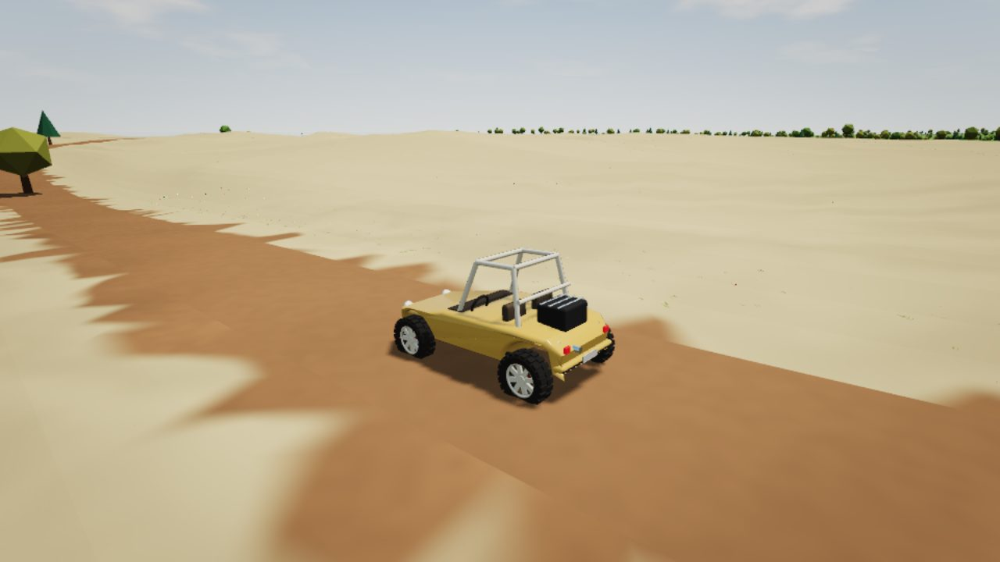
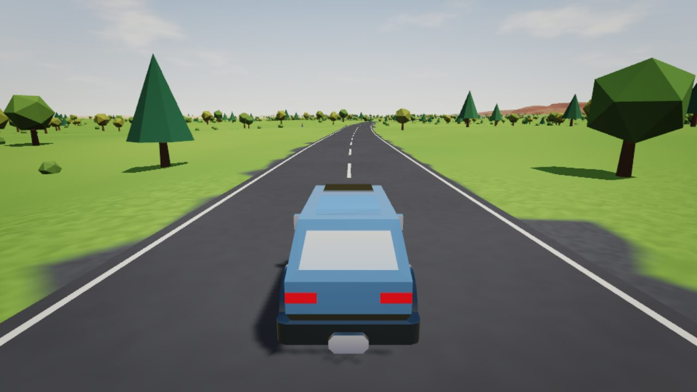
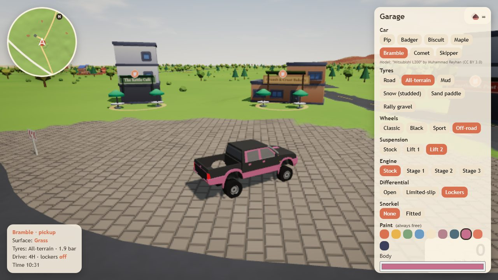

# Cozy Drive (working title)

A cozy, offline, open-world driving game for the browser. This repository holds the **M0/M1 prototype** from the plan in [docs/](docs/README.md).



| | |
|---|---|
|  |  |
| *Village plaza: the starting point* | *Canyon track in the 4×4* |
|  |  |
| *Dune trail in the buggy* | *Cross-island highway in the camper van* |


*The garage: every change previews instantly on the car.*

Screenshots come from the real game and can be regenerated with `npm run screenshots`.

## Run it

```bash
npm install
npm run dev        # http://localhost:5173 with hot reload
npm test           # world, physics and acceptance tests (Node, headless)
npm run build      # production build + offline service worker in dist/
npm run smoke      # builds, opens the game in installed Chrome, drives, checks offline boot
```

For realistic frame rates in the smoke test on a machine with a GPU: `SMOKE_GPU=1 node tools/smoke.mjs <screenshot-dir>`.
To screenshot a tour of the island: `node tools/tour.mjs <screenshot-dir>`. To measure frame rate per layer: `node tools/perf.mjs`. To measure driving smoothness: `node tools/smoothness.mjs` (add `THROTTLE=4` to emulate a slow CPU).
To screenshot every car type in the garage: `npm run build && node tools/cars.mjs <screenshot-dir> [hour]`.

## Controls

| Action | Keyboard | Gamepad |
|---|---|---|
| Drive / brake / reverse | W / S (or arrows) | Right / left trigger |
| Steer | A / D | Left stick |
| Handbrake | Space | A |
| Flip back onto wheels | R | Y |
| Camera (chase, far, hood) | C · drag the mouse to look around | B |
| Garage | G | Start |
| Tyre pressure down / up | [ / ] | Bumpers |
| Low range (4×4) / diff lockers | F / L | X / – |
| Cruise control (brake cancels) | K | D-pad up |
| Help, mute | H, M | Back |

## What's in the prototype

- **Island:** a generated 4 × 4 km island with a village, a 9 km coastal highway loop, a 3 km cross-island highway, gravel and dirt tracks, a mountain pass, a boardwalk, a lake, a frozen pond, dunes, a red-rock canyon, snowy peaks and a marsh. Built in a background worker on first launch and cached.
- **12 surfaces** with their own grip, rolling resistance, particles and rolling sound, from the plan's tables.
- **7 car types:** hatchback, 4×4 (low range, lockers), camper van, sedan, pickup, sports coupe and dune buggy. Five use CC0 models from Kenney's Car Kit, see [CREDITS.md](CREDITS.md).
- **Garage:** car type, 6 tyre types, 4 wheel styles, lift, engine stage, differential, snorkel, paint and accent colours, 5 finishes, driving assists, with live stat bars.
- **Physics:** custom ray-cast vehicle on Rapier at 120 Hz, verified by automated acceptance tests.
- **Cozy systems:** day/night cycle, gentle rescue from deep water, flip-back, autosave to IndexedDB, offline play after the first visit.

## Layout

```
src/core          loop, input, math, storage
src/world         generation, roads, surfaces, terrain, props, village, sky
src/vehicle       specs, physics, models, visual sync
src/customization build → spec (pure, tested)
src/camera, src/ui, src/audio, src/fx
tests/            vitest suites + headless sim helper
tools/smoke.mjs   browser smoke test
docs/             the dev plan and decision records
```

## Status

Early prototype (milestones M0–M1 of the [roadmap](docs/08-roadmap.md), plus parts of M2 and M3). Expect rough edges.

## Licence

Third-party assets and their licences are listed in [CREDITS.md](CREDITS.md). The project's own code has no licence chosen yet, so all rights are reserved until one is added.
